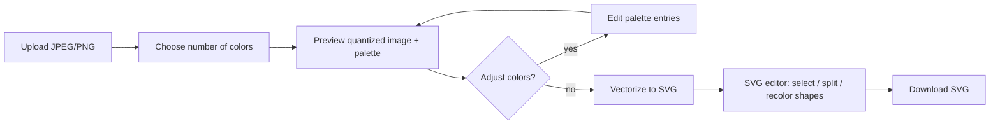

# 01. Project Overview

## Purpose

VectorSnap is a tool for converting raster images (JPEG, PNG) into SVG vector graphics
with explicit control over the color palette. It targets use cases such as logos,
icons, illustrations, stickers, cutting plotters and print preparation, where a
small, well-defined set of flat colors is preferable to a photorealistic trace.

## Goals

1. **Raster → vector conversion.** Produce clean, compact SVG output from JPEG/PNG input.
2. **Palette control.** Let the user reduce the image to an exact number of colors
   *before* tracing, and adjust those colors manually.
3. **Post-trace editing.** Allow the user to split individual vector shapes into
   smaller parts and recolor them, to fix tracing artifacts without an external editor.
4. **Reusable backend.** The processing engine is a standalone, stateless HTTP
   service that other applications can call (microservice).
5. **Easy deployment.** Every component runs in a container; the whole stack
   starts with a single `docker compose up`.

## Non-goals (for the initial version)

- Photorealistic / gradient-preserving vectorization.
- Full-featured vector editor (layers, text, bezier handle editing, etc.).
- User accounts, persistent project storage, collaboration.
- Batch processing of many files in one request (see [Roadmap](11-roadmap.md)).

## High-level user flow

## Glossary

| Term | Meaning |
|------|---------|
| **Raster image** | Pixel-based image (JPEG, PNG). |
| **Vector image / SVG** | Image described by geometric shapes (paths) — Scalable Vector Graphics. |
| **Quantization** | Reducing the number of distinct colors in an image to *N* representative colors. |
| **Palette** | The ordered list of *N* colors produced by quantization. Each entry has an index, a hex value and pixel coverage. |
| **Label map** | Per-pixel array of palette indices produced by quantization. |
| **Vectorization / tracing** | Converting color regions of a raster image into SVG paths. |
| **Shape** | A single `<path>` element in the output SVG. |
| **Split** | Dividing one shape into two or more shapes along a user-drawn line or region. |
| **Palette group** | All shapes that share the same palette color. |
