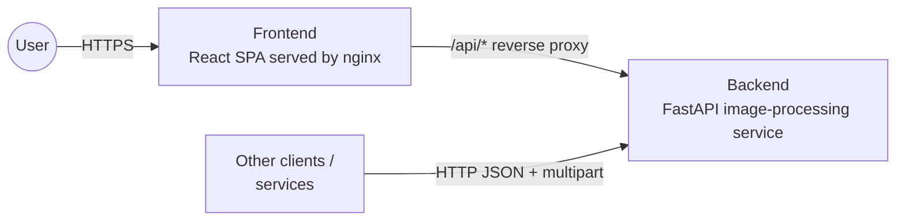
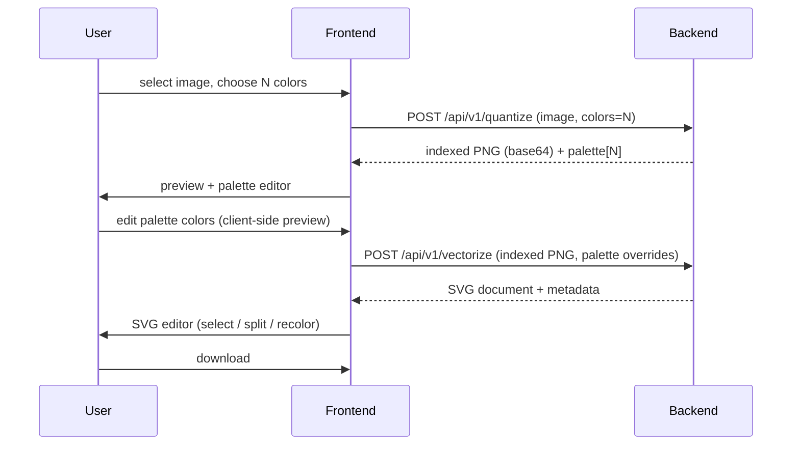
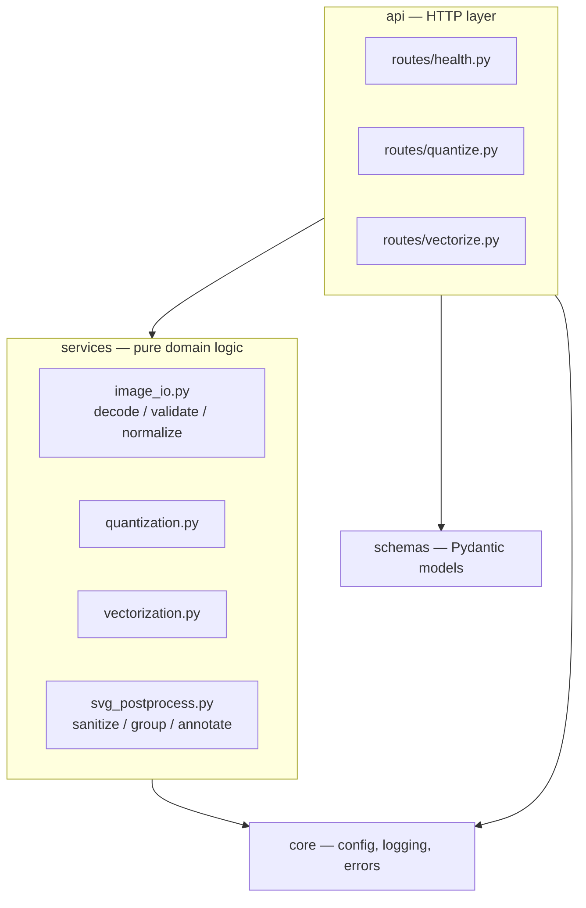
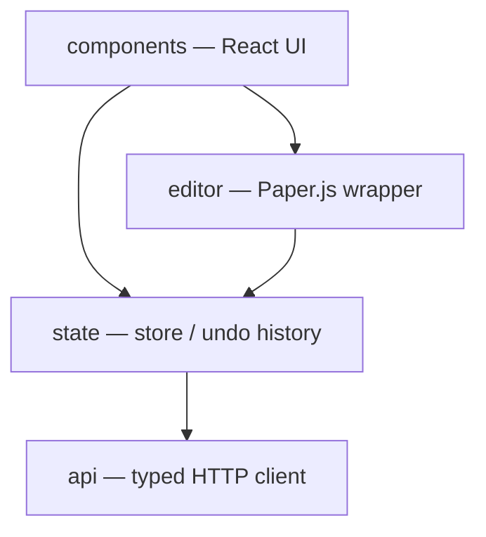

# 03. Architecture

## System context

The **frontend** is a static single-page application. In the containerized setup it is
served by nginx, which also reverse-proxies `/api/*` to the backend, so the browser
talks to a single origin (no CORS needed in production).

The **backend** is a stateless HTTP service. It knows nothing about the frontend and can
be called by any other client (CLI tools, other microservices, automation pipelines).

## Responsibilities

| Concern | Frontend | Backend |
|---------|:--------:|:-------:|
| File selection, drag & drop, preview | ✅ | |
| Input validation (type, size, dimensions) | basic (UX) | ✅ authoritative |
| Color quantization | | ✅ |
| Palette editing (choosing new colors) | ✅ | applies overrides |
| Live recolor preview of quantized image | ✅ (canvas, client-side) | |
| Vectorization (tracing) | | ✅ |
| SVG sanitization & normalization | | ✅ |
| Interactive SVG editing (select, split, recolor, undo) | ✅ (Paper.js) | |
| Export / download | ✅ | |

Interactive editing is done client-side on purpose: it needs sub-100 ms feedback and
operates on data already present in the browser. The backend stays focused on the
CPU-heavy, deterministic transformations.

## Stateless round trip

The backend never stores images. State that must survive between steps is carried by
the client:

The quantized image is returned as an **indexed (palette-mode) PNG**. It is lossless and
encodes the per-pixel label map, so the vectorize step can reuse it exactly without
re-running quantization and without server-side sessions.

## Backend internal layers

Rules:

- `services` contain no FastAPI imports; they operate on NumPy arrays / bytes / strings
  and are unit-testable in isolation. This also makes it possible to reuse them from a
  CLI or a queue worker later.
- `api` translates HTTP to service calls and maps domain exceptions to HTTP errors.
- CPU-bound service calls are executed in a thread pool (`run_in_threadpool`) so the
  event loop stays responsive.

## Frontend internal layers

See [07-frontend.md](07-frontend.md) and [08-svg-editor.md](08-svg-editor.md).

## Scaling and deployment

- The backend is CPU-bound and stateless → scale horizontally behind any load balancer.
- Worker count per container is controlled with `UVICORN_WORKERS` (default: 1 per vCPU).
- The frontend is static files → can be served from any CDN/object storage instead of nginx.
- For very large images or batch jobs, an asynchronous job API backed by a queue is
  planned (see [Roadmap](11-roadmap.md)); the service layer is already decoupled for it.
