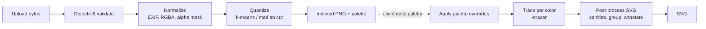

# 06. Image Processing Pipeline

## 1. Decode & validate (`services/image_io.py`)

1. Enforce byte limit while reading the upload stream.
2. Open with Pillow; reject if `format not in {"JPEG", "PNG"}` → `415`.
3. Check `width`, `height` ≤ `MAX_IMAGE_DIMENSION` → otherwise `422 IMAGE_TOO_LARGE`.
4. `Image.MAX_IMAGE_PIXELS` is set globally as a decompression-bomb guard.
5. Call `img.load()` inside `try` to surface truncated/corrupt files as `422 INVALID_IMAGE`.

## 2. Normalize

- Apply `ImageOps.exif_transpose` (JPEG orientation).
- Convert to `RGBA`. Build an **alpha mask**: pixels with `alpha < 128` are treated as
  transparent and excluded from clustering and tracing.
- Composite semi-transparent pixels over white for color computation (configurable later).
- Convert to a NumPy array `H×W×3 uint8` plus `H×W bool` mask.

## 3. Quantization (`services/quantization.py`)

Output: `labels: H×W uint8` (palette index per pixel, 255 = transparent) and
`palette: N×3 uint8`.

### k-means (default)

1. Collect the **unique colors** of all opaque pixels (packed as 24-bit integers) with
   their pixel counts. If there are no more than `colors` of them (logos, icons) and no
   colors are locked, they are used as the palette **exactly** — no clustering.
2. Downscale to `max_working_size` on the longer side (Lanczos) to bound cost and take the
   unique colors of the downscaled copy, weighted by pixel count.
3. Convert them to **CIE Lab** (D65) — Euclidean distance in Lab approximates perceived
   color difference far better than in RGB.
4. Fit `MiniBatchKMeans(n_clusters=N, random_state=seed, n_init=3)` with the counts as
   `sample_weight`.
5. `locked_colors`: each locked color replaces its nearest still-free centroid (greedy).
6. Assign every unique color of the **full-resolution** image to the nearest centroid
   (chunked to bound memory), then map pixels through the unique-color index.
7. Palette entry = pixel-weighted **mean sRGB** of its members (avoids Lab → sRGB gamut
   issues); locked entries keep their exact value.

### Median cut (alternative)

Pillow's `Image.quantize(colors=N, method=Image.Quantize.MEDIANCUT, dither=NONE)`.
Faster and fully deterministic, slightly worse visual quality on gradients. Useful for
large images or as a fallback.

### Post-quantization cleanup

- **Dithering is always disabled** — dithered noise produces thousands of tiny paths.
- Optional **mode filter** (3×3 majority) to remove isolated pixels before tracing.
- Remove empty clusters (can happen with k-means on low-variety images); palette size may
  therefore be smaller than requested — the response reflects the actual size.
- Sort palette by coverage (descending) and remap labels accordingly.

### Encoding

The label map is written as a palette-mode PNG (`Image.fromarray(labels, "P")` +
`putpalette`). Transparent pixels use a dedicated index declared in `tRNS`.

## 4. Applying palette overrides

`palette` from the vectorize request replaces colors **by index**; the label map is
untouched. Indices that end up with the same hex value are merged into a single color
layer before tracing, which removes the seam between them.

## 5. Vectorization (`services/vectorization.py`)

The label map is rendered back to an RGBA image using the final palette and passed to
**vtracer** (`convert_raw_image_to_svg` / `convert_pixels_to_svg`) with:

| vtracer option | Source |
|----------------|--------|
| `colormode="color"` | fixed |
| `hierarchical` | `stacked` → `"stacked"`, `cutout` → `"cutout"` |
| `mode` | `spline` / `polygon` |
| `filter_speckle`, `corner_threshold`, `length_threshold`, `splice_threshold`, `path_precision` | request params |
| `color_precision=8`, `layer_difference=0` | fixed — input already has exact flat colors, so vtracer must not re-cluster |

**Why `cutout` matters for editing:** in `stacked` mode a shape may lie on top of a
larger background shape, so splitting the top shape would reveal the color beneath.
`cutout` produces non-overlapping regions (holes are real holes), which makes
splitting and recoloring behave intuitively. The frontend therefore requests `cutout`
by default; `stacked` remains available for smaller file size.

## 6. SVG post-processing (`services/svg_postprocess.py`)

1. Parse with `lxml` (`resolve_entities=False`, `no_network=True`).
2. Map each path's `fill` back to a palette index (exact hex match).
3. Group paths into `<g data-palette-index="n" fill="#...">` ordered by coverage.
4. Assign ids `p-{index}-{seq}`, strip per-path `fill` and `transform` (vtracer emits
   `transform="translate(x,y)"` — it is baked into the path coordinates).
5. Allow-list sanitization (elements & attributes, see [backend](04-backend.md#security-considerations)).
6. Set `viewBox`, `width`, `height`, `data-generator`.
7. Serialize without XML declaration, minified whitespace.

## Quality & performance targets

| Input | Colors | Quantize | Vectorize | Target |
|-------|--------|----------|-----------|--------|
| 1024×1024 PNG logo | 8 | < 1 s | < 2 s | NFR-05 |
| 1024×1024 JPEG photo | 16 | < 2 s | < 5 s | NFR-05 |
| 4096×4096 PNG | 32 | < 8 s | < 20 s | best effort |

A small benchmark script (`backend/scripts/benchmark.py`, planned) tracks these numbers
against fixtures in `backend/tests/fixtures/`.
