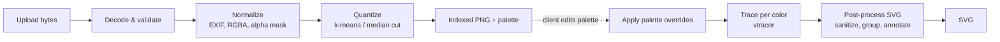

# 06. Image Processing Pipeline

## 1. Decode & validate (`services/image_io.py`)

1. Enforce byte limit while reading the upload stream.
2. Open with Pillow; reject if `format not in {"JPEG", "PNG"}` → `415`.
3. Check `width`, `height` ≤ `MAX_IMAGE_DIMENSION` → otherwise `422 IMAGE_TOO_LARGE`.
4. `Image.MAX_IMAGE_PIXELS` is set globally as a decompression-bomb guard.
5. Call `img.load()` inside `try` to surface truncated/corrupt files as `422 INVALID_IMAGE`.

## 2. Normalize

- Apply `ImageOps.exif_transpose` (JPEG orientation).
- Convert to `RGBA`.
- Optional **upscaling** (`upscale=true` on `/quantize`): an image whose longer side is
  below 1024 px is enlarged with Lanczos by a whole factor `min(4, ⌈1024 / longest⌉)`
  (never beyond `max_image_dimension`). The anti-aliased edges of small logos and icons
  then become smooth color boundaries instead of pixel stairs, so traced outlines — and
  the walls of 3D exports — follow the intended shape. Pillow premultiplies alpha while
  resizing, so transparent edges do not darken. The response reports the enlarged size.
- Build an **alpha mask**: pixels with `alpha < 128` are treated as
  transparent and excluded from clustering and tracing.
- Composite semi-transparent pixels over white for color computation (configurable later).
- Convert to a NumPy array `H×W×3 uint8` plus `H×W bool` mask.

## 3. Quantization (`services/quantization.py`)

Output: `labels: H×W uint8` (palette index per pixel, 255 = transparent) and
`palette: N×3 uint8`.

### k-means (default)

1. Collect the **unique colors** of all opaque pixels (packed as 24-bit integers) with
   their pixel counts. If there are no more than `colors` of them (logos, icons) and no
   colors are locked, they are used as the palette **exactly** — no clustering.
2. Downscale to `max_working_size` on the longer side (Lanczos) to bound cost and take the
   unique colors of the downscaled copy, weighted by pixel count.
3. Convert them to **CIE Lab** (D65) — Euclidean distance in Lab approximates perceived
   color difference far better than in RGB.
4. Fit `MiniBatchKMeans(n_clusters=N, random_state=seed, n_init=3)` with the counts as
   `sample_weight`. If the downscaled copy has no more unique colors than `N` (possible
   when colors are locked), those colors are used as the centers directly — k-means can
   return duplicate centers in that case and would merge colors.
5. `locked_colors`: each locked color replaces its nearest still-free centroid (greedy).
6. Assign every unique color of the **full-resolution** image to the nearest centroid
   (chunked to bound memory), then map pixels through the unique-color index.
7. Palette entry = pixel-weighted **mean sRGB** of its members (avoids Lab → sRGB gamut
   issues); locked entries keep their exact value.

### Median cut (alternative)

Pillow's `Image.quantize(colors=N, method=Image.Quantize.MEDIANCUT, dither=NONE)`.
Faster and fully deterministic, slightly worse visual quality on gradients. Useful for
large images or as a fallback.

`locked_colors` work the same way as for k-means: each locked color replaces its nearest
still-free palette entry (greedy, in Lab), and every opaque pixel is then reassigned to
the nearest entry of the adjusted palette in Lab.

### Color count suggestion

`suggest_color_count` (`POST /suggest-colors`) proposes a value for `colors`:

1. **Flat images** (logos, icons) with no more unique opaque colors than `max_colors`
   get exactly their color count (at least `min_colors`).
2. Otherwise the image is downscaled to 128 px on the longer side and its unique colors
   (weighted by pixel count) are clustered in Lab with `KMeans(n_init=1, random_state=0)`
   for `k = min_colors, min_colors + 1, …` up to `min(max_colors, 24)`.
3. For each `k` the **mean ΔE** (CIE76, pixel-weighted distance to the nearest center) is
   computed; the first `k` with mean ΔE ≤ 5 — barely noticeable — is returned.
4. If no `k` gets there (smooth gradients, photos), the **elbow** of the error curve is
   returned: the point farthest below the straight line between its ends, after
   normalizing both axes.

Full `KMeans` is used instead of `MiniBatchKMeans` here: on the small sample it is about
3× faster across the ~20 fits, keeping the request well under a second.

### Post-quantization cleanup

- **Dithering is always disabled** — dithered noise produces thousands of tiny paths.
- Optional **region smoothing** (`smooth` = 1–3, `smooth_regions`): a majority (mode)
  filter with a (2n+1)×(2n+1) window replaces every opaque pixel with the most common
  label around it (Pillow `ModeFilter`; values seen only once or twice never win).
  Removes specks and evens out jagged edges from photos, scans and JPEG artefacts, so
  tracing produces fewer, cleaner shapes — and 3D layers without unprintable crumbs.
  Transparency is never changed: a transparent majority does not erase opaque pixels.
  Colors that disappear are dropped and the palette is re-sorted. Cost: ~1 s per
  4 MP, independent of the strength.
- Remove empty clusters (can happen with k-means on low-variety images); palette size may
  therefore be smaller than requested — the response reflects the actual size.
- Sort palette by coverage (descending) and remap labels accordingly.

### Encoding

The label map is written as a palette-mode PNG (`Image.fromarray(labels, "P")` +
`putpalette`). Transparent pixels use a dedicated index declared in `tRNS`.

## 4. Applying palette overrides

`palette` from the vectorize request replaces colors **by index**; the label map is
untouched. Indices that end up with the same hex value are merged into a single color
layer before tracing, which removes the seam between them.

## 5. Vectorization (`services/vectorization.py`)

Each **color layer** (palette indices with identical final color, in coverage order) is
traced separately: its mask is rendered black-on-white and passed to **vtracer** in
**binary mode** (`convert_raw_image_to_svg(colormode="binary", ...)`). See
[ADR 0006](adr/0006-per-color-binary-tracing.md) for why vtracer's color mode is not used.

| Stacking | Layer mask | Result |
|----------|-----------|--------|
| `cutout` (default) | pixels of this color only | Non-overlapping shapes; holes are real holes |
| `stacked` | pixels of this color **and every layer above it** | Lower layers extend under upper ones → no seams between colors; shapes overlap |

Colors without any pixels of their own are skipped. Transparent pixels are never part of
any mask.

| vtracer option | Source |
|----------------|--------|
| `colormode="binary"` | fixed |
| `mode` | `spline` / `polygon` |
| `filter_speckle`, `corner_threshold`, `length_threshold`, `splice_threshold`, `path_precision` | request params |

**Why `cutout` matters for editing:** in `stacked` mode a shape lies on top of the layers
below it, so splitting or deleting it would reveal the color beneath. `cutout` makes
splitting and recoloring behave intuitively, which is why it is the default.
In `cutout` + `spline` mode, adjacent colors are smoothed independently, so hairline
seams may be visible at some zoom levels; `polygon` mode or `stacked` avoid them.

## 6. SVG post-processing (`services/svg_postprocess.py`)

1. Parse each layer's vtracer output with `lxml` (`resolve_entities=False`,
   `no_network=True`, comments removed).
2. Read only the `d` attribute of each `<path>`; vtracer emits
   `transform="translate(x,y)"`, which is **baked into the coordinates** (vtracer only
   emits absolute `M`/`L`/`C`/`Z` commands, so numbers alternate between x and y).
3. **Rebuild the document from scratch**: `<svg viewBox width height data-generator>`,
   one `<g id="color-n" data-palette-index="n" fill="#...">` per layer, paths with
   `id="p-{index}-{seq}"` and `data-palette-index`. Colors come from the palette, never
   from tracer output, so nothing outside this allow-list can reach the client.
4. Serialize without XML declaration or whitespace.

## Quality & performance targets

| Input | Colors | Quantize | Vectorize | Target |
|-------|--------|----------|-----------|--------|
| 1024×1024 PNG logo | 8 | < 1 s | < 2 s | NFR-05 |
| 1024×1024 JPEG photo | 16 | < 2 s | < 5 s | NFR-05 |
| 4096×4096 PNG | 32 | < 8 s | < 20 s | best effort |

A small benchmark script (`backend/scripts/benchmark.py`, planned) tracks these numbers
against fixtures in `backend/tests/fixtures/`.
