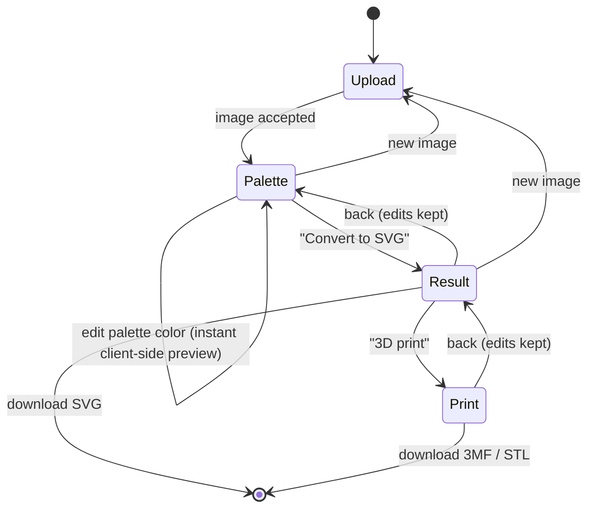

# 07. Frontend Application

## Technology stack

| Purpose | Library |
|---------|---------|
| UI framework | React 18 + TypeScript |
| Build tool / dev server | Vite |
| State management | Zustand (with a command-based undo/redo history) |
| Vector editing | Paper.js (hit-testing, boolean path operations, SVG import/export) |
| 3D preview | three.js (3MFLoader, STLLoader, OrbitControls), lazy-loaded |
| Color picker | Native `<input type="color">` (richer picker planned) |
| Linting / formatting | ESLint, Prettier |
| Tests | Vitest + React Testing Library, Playwright (E2E, later) |

## Screen flow

The application is a single page with a four-step wizard (upload, colors, SVG, 3D print). Going back to the colors step
keeps the palette edits; changing the color count or method re-quantizes and resets them
(palette indices change).

The step indicator in the header is the navigation: completed steps show a check mark,
and every step that is reachable (`reachableSteps` in the store — colors once an image is
chosen, SVG and 3D print once it has been converted) is a button, so the user can jump between the
colors and the editor without losing edits. `goTo` ignores unreachable steps.



Status legend: ✅ implemented · 🔜 planned (see [Roadmap](11-roadmap.md)).

### Step 1 — Upload ✅

- Drop zone, file picker and paste from clipboard; only JPEG/PNG are accepted. The zone
  highlights while a file is dragged over it ("Release to upload"); the file input is
  visually hidden inside a styled "Choose image" button and stays keyboard reachable.
- Accepted formats and the upload limit (`max_upload_mb`) are shown under the button.
- **Try a sample**: loads the bundled `public/sample.png` (a flat-color logo with
  anti-aliased edges, `src/lib/sample.ts`) as if it had been chosen, so the whole
  workflow can be tried without a file.
- File size is checked against `GET /api/v1/limits` (loaded on startup, defaults used if
  unavailable); the backend remains authoritative — its error message is shown inline.

### Step 2 — Colors & palette ✅

Layout: left = original and quantized previews side by side, right = controls. On wide
windows (≥ 1100 × 640 px) the previews — and the editor in the result step — are
`position: sticky`, so they stay in view while the long control panel scrolls (palette,
tracing and export options). Narrower windows stack everything and scroll normally.

- **Color count**: slider + numeric input (`min_colors`…`max_colors`, default 8).
  Changing it triggers `POST /quantize`, debounced 400 ms; a newer request aborts the
  previous one (`AbortController`). Unchanged parameters never re-quantize, so returning
  from the result step keeps edits.
- **Suggest**: asks `POST /suggest-colors` for a color count and applies it (clamped to
  the limits and the number of locked colors); a hint shows the suggestion with a "use
  it" link once the count is changed. Runs with its own `AbortController`, so it never
  cancels a quantization in flight.
- **Method**: perceptual (k-means) / fast (median cut) / **My filaments** — for 3D
  printing the palette is chosen from real filament colors
  (`algorithm: 'filaments'`, see
  [06](06-image-processing-pipeline.md#filaments-for-3d-printing)): the
  `FilamentLibraryPanel` lists 24 common PLA colors (approximate) and the user's own,
  as chips to tick what is on the shelf (All / None) plus a color + name form for exact
  spool colors. The library (`lib/filamentLibrary.ts`) is stored in the browser
  (`vectorsnap.filament-library`) and kept across images; changing it re-runs the
  quantization. The color count becomes a maximum — only the filaments the image needs
  are used — and palette rows show the filament name under the hex.
- **3D printing tips** (`PaletteAdvice`, logic in `lib/paletteAdvice.ts`): every color
  is a filament slot with color changes and purge waste, so the panel lists
  - **similar colors** — pairs closer than CIEDE2000 16 (`≈`; below 8 `≈≈`, nearly
    identical), most alike first, each color in one pair at most, with **Merge**
    (the smaller color takes the larger one's value, i.e. a palette override, which merges
    them in the SVG);
  - **tiny areas** — colors under 0.5 % of the image, with Merge into the nearest color;
  - **Use my filaments** — replaces every color by the nearest available filament of the
    library (colors mapping to one filament merge), listing which filaments result.

  Differences use **CIEDE2000** (`deltaE2000` in `lib/color.ts`, verified against the
  Sharma–Wu–Dalal reference data): CIE76 overstates differences of saturated colors, so
  one threshold would not mean "looks alike" across the gamut. Two olive shades of one
  area (ΔE2000 15) are offered for merging; yellow-green vs. gold (16.6) stay apart.
- **Smooth regions**: Off / Light / Medium / Strong, sent as `smooth` 0–3 (default
  Light). Removes specks and jagged edges, which matters most for photos and 3D prints;
  changing it re-quantizes like the other parameters.
- **Enlarge small images** (on by default, sent as `upscale`): images under 1024 px are
  scaled up before quantizing, so small logos trace into smooth outlines and 3D edges.
- **Remove colors / background**: the eye toggle on a palette row leaves that color out
  of the SVG (sent as `transparent`); the preview shows it as transparent over a
  checkerboard. "Remove background" appears when `/quantize` reports a
  `background_index`. At least one color always stays, and removed colors are reset
  whenever the image is quantized again (indices change).
- **Locked colors** (FR-16): the lock toggle on a palette row, or "Lock color" with a
  color picker for brand colors, adds a color to `locked`. Locked colors are sent as
  `locked_colors` and re-quantize (debounced like the color count); the backend keeps
  them exactly in the palette. At most `colors` colors can be locked, and the color count
  cannot go below the number of locked colors. Locked colors persist across images until
  "New image".
- **Share strip**: above the list, one bar with every color as wide as its share of the
  image (removed colors hatched), so the colors that make up most of the design and
  the print stand out.
- **Palette list**: one row per color — color picker, hex value, coverage bar, per-color
  reset and "Reset all".
  - Edits are previewed **instantly client-side**: the indexed PNG is decoded onto a
    `<canvas>` and every pixel is mapped from its original palette color to the edited
    color (`src/lib/recolor.ts`) — no server call.
  - Merge: give two colors the same value; they become one region in the SVG.
  - 🔜 Hover highlighting, drag-to-merge.
- **Tracing options** (collapsible): curves (spline/polygon), shapes (cutout/stacked),
  speck filter, corner threshold and an **Advanced** subsection with minimum segment
  length, splice threshold (both spline only, disabled in polygon mode) and coordinate
  precision (FR-24). Values are clamped to the ranges accepted by `POST /vectorize`
  (`src/lib/tracing.ts`); "Restore defaults" resets all tracing options.
- **Convert to SVG** → `POST /vectorize` with the indexed PNG and the final palette.

### Step 3 — SVG editor

- ✅ Interactive canvas ([08-svg-editor.md](08-svg-editor.md)): select shapes by click
  (with hover preview), box selection, `Ctrl/Cmd+A`; pan (Hand tool, `Space`+drag, middle
  button), zoom (wheel, toolbar, `+`/`-`/`0`); inspector with the selected shapes.
- ✅ Recolor the selection (own color / back to group color) and whole color groups.
- ✅ Knife tool: split shapes along a freehand or straight line.
- ✅ Lasso tool: cut a freehand region out of a shape.
- ✅ Select shapes smaller than an area (specks) to delete, recolor or move them at once.
- ✅ Merge shapes and move them between color groups.
- ✅ Move the selection (drag, arrow keys); scale, flip and rotate it.
- ✅ **Fragments**: save the selection (with its colors) in a library kept in the browser,
  rename and delete saved fragments, export and import the library as a JSON file, and
  place a fragment on top of another image (own colors or the image's nearest colors)
  ([08-svg-editor.md](08-svg-editor.md#fragments-)).
- ✅ Export panel (STL, 3MF, lithophane, DXF, PDF, EPS, PNG) with per-color heights and a 3D
  preview with print statistics ([13-export-formats.md](13-export-formats.md)).
- ✅ Delete shapes, undo/redo every edit (toolbar and keyboard).
- ✅ **Compare with original**: a view switch above the editor shows the original upload
  and the current (edited) SVG on top of each other, split by a divider that follows the
  pointer (drag) or a range slider (keyboard). The stage keeps the image's aspect ratio,
  so the divider position is relative to the image; switching back remounts the editor.
- ✅ Shape count, file size, tracing time, back to colors, new image.
- ✅ **Unsaved edits are protected**: the document counts as unsaved when it was edited
  since it was converted or last downloaded as SVG (`hasUnsavedEdits`; undoing back to the
  converted or downloaded version counts as saved). Starting with a new image, choosing a
  new file or converting again then asks in a modal dialog ("Keep editing" has focus, so
  Enter and Escape never discard), and closing or reloading the tab triggers the
  browser's leave-page warning.
- ✅ Download exports the **edited** document in the SVG contract; shape count and file
  size reflect the edits.

### Step 4 — 3D print ✅

A dedicated step for printable objects (`PrintStep`, logic in `src/lib/printPlan.ts`,
unit-tested), opened from the "3D print" button in the SVG step or the header:

- **Project presets** set size, base and extras; colors and raised elements are kept,
  and editing any preset value switches to *Custom*:

  | Project | Width | Base | Base plate | Extras |
  |---------|-------|------|------------|--------|
  | Fridge magnet | 60 mm | 12 layers (2.4 mm) | design outline + 2 mm | 10.2 × 2 mm magnet pocket |
  | Keychain | 45 mm | 10 layers (2 mm) | outline + 2 mm | 4 mm loop |
  | Christmas ornament | 80 mm | 8 layers (1.6 mm) | circle + 2 mm | 3 mm loop |
  | Sign or coaster | 100 mm | 10 layers (2 mm) | rounded rectangle + 5 mm | — |
  | Flat coaster | 100 mm | 15 layers (3 mm) | circle + 4 mm | colors inlaid flush (flat top) |

- **Colors: Flat (AMS)** — every color has the same height, so the top is level and a
  multi-color printer switches colors within the same layers; **Stepped** — each color
  one step higher, for a single extruder with filament changes (the filament plan is
  offered); **Mixed** — flat, with more colors than filaments (see below); **Cut out** —
  one filament, see below.
- **Cut out** (`style: 'cutout'`, sent as `relief=engrave`): lettering made of missing
  filament. The ticked colors are cut out of the base plate, the others stay solid (the
  table reads *Cut out per color* and *solid*); the colors field is the **cut depth**, and
  extra layers per color or element cut deeper. **Cut through (stencil)** (`cutThrough`)
  makes every cut as deep as the plate: holes, where the middle of an O or A prints as a
  loose piece. Switching to it (`cutoutChange`) keeps a plate of at least 3 mm, cuts
  1 mm deep and, when every color was printed, leaves the bottom color — the background —
  solid, so only the lettering on it is cut out. The model is as high as the plate and
  needs one filament, so the filament checks and change estimate say no changes. A cut
  deeper than the plate (without *Cut through*) or no plate is an error on the field; the
  inlay checkbox is hidden. The export panel offers the same as *Cut out of the base
  plate (one filament)*.
- **Mixed colors** (`style: 'mixed'`): the panel lists the **loaded filaments**
  (`FilamentSlots`, up to 4 — one AMS; color and TD, slot 1 also prints the base plate)
  and, per design color, the predicted print color, the recipe (thin layers × count from
  the top, on a base filament) and its ΔE (`MixTable`; above 10 flagged, with advice to
  load a closer filament or add color layers). Switching to Mixed sets 0.08 mm layers,
  keeps the base and color heights in mm with at least 15 color layers (1.2 mm — thinner
  colors look washed out over the white base), and suggests filaments: white plus the
  most used, clearly different design colors with typical TDs (`suggestFilaments`,
  `typicalTd`), which the user replaces with the real ones. The design view can show the
  predicted colors. Exports send `filaments` and `color_stacks` (`mixPlan`), so the 3MF
  has parts only in the filament colors. Projects keep the style and the filaments.
- **Test card** (`testCard`): *Download test card (3MF)* exports one 10 mm square patch
  per mixed color (rows of 4, in the order of the table, 1 document unit = 1 mm) on a
  rectangular base, with the same recipes and heights but without loop, magnet or raised
  elements — a quick print to compare the real colors with the predictions and adjust
  the TDs before printing the design.
- **Size**: **Width (mm)** of the design, or its **Height (mm)**, which sets the width
  from the design's proportions (border and loop come on top).
- **Heights in printer layers**: printer layer height (0.08–0.28 mm), base plate and color
  height are whole layers (shown in mm too), so colors change exactly at a layer.
- **Height per color**: the model starts flat; include/leave out a color and give it
  extra layers, e.g. a logo raised 3 layers above the rest. **Automatic relief** (dark
  on top / light on top, `reliefRaise` in `src/lib/printPlan.ts`) ranks the printed
  colors by brightness and raises each one layer above the previous one; the values can
  be adjusted afterwards, and **Make all colors flat again** clears them.
- **Printed size**: the design view draws dimension lines under and beside the design
  with its printed width and height (*80 mm*, *50 mm*), following the width and height
  fields. Only the design is mirrored for a stamp, so the labels stay readable.
- **Side view** (`LayerProfile`): under the colors table, the print from the side, to
  scale in height: the base plate in gray and one column per printed color at its height
  (steps, raised colors, inlaid colors flush with the top). Cut-out prints have none.
- **Raised elements**: the design view is a clickable map (`ElementMap`, the shapes of
  the edited document): click selects an element, Shift/Ctrl/Cmd+click adds or removes,
  clicking empty space clears. The panel raises the selection by whole layers (− / +),
  shows "different heights" for a mixed selection, and resets one or all. Raised
  elements get a dashed outline, the selection an accent outline. Raises are stored per
  shape id and sent as `shape_heights` (color height + extra layers), so the backend
  prints them as their own parts — e.g. letters 3 layers above a flat AMS sign.
- **Base plate**: shape (outline, rectangle, rounded, circle, oval, hexagon; one list in `src/lib/baseShapes.ts` for the print step, the export panel and settings files), border, raised rim (as
  high as the colors), hanging loop (with the side it sticks out of, `loop_position`),
  magnet pocket (depth checked against the base; **Magnets** 1–4 spreads several along
  the longer side, `magnet_count`), and
  **Set the colors into the base (flat top)** (`inlay`, sent as `relief=inlay`): colors
  sink their height into the plate, which must then be thicker than the tallest color —
  and a magnet pocket must fit below them; the total height is then the base alone.
- **API command (curl)** (`ApiCommand`, `src/lib/apiCommand.ts`, collapsed at the end of
  the panel): the 3MF export of the current settings as a `curl` command — one `-F` field
  per line, values quoted for a POSIX shell, the endpoint resolved against the page (or
  `VITE_API_BASE_URL`) — for the SVG saved from the editor under the shown name. Shown in
  the page and copied with **Copy command**; when the browser blocks the clipboard it says
  so and the command stays selectable. Only shown for valid settings.
- **Undo a project or settings file** (`PrintUndo`, `printUndo` / `undoPrintChange` in the
  store): both change many settings at once, so afterwards *Applied Keychain. Undo* (or
  the file's name) restores the settings from before — printer memory included. The next
  change of any setting removes the offer, as undoing would also revert that change;
  *Custom* changes nothing and converting a new SVG drops it (its colors and raises
  belong to the old design).
- **My projects** (`MyProjects`, `src/lib/myProjects.ts`): under the projects, **Save as
  my project…** asks for a name and keeps the current print settings in this browser
  (`localStorage` `vectorsnap.my-projects`, at most 12, newest first; the same name, in
  any case, is replaced). Each is stored as a print settings file (below), so the
  per-design choices stay out. A click applies it like loading that file
  (`loadPrintSettings`, with undo), marked *Custom*; × removes it. Saved projects stay
  when a new image is opened; unreadable ones are skipped.
- **Save / load print settings** (`PrintSettingsFile`, `src/lib/printPreset.ts`): below the
  projects, **Save print settings** downloads `<image>.print.json` (`kind`
  `vectorsnap-print-settings`, `version` 1) with the project, printer, sizes, base plate,
  tuning and filaments — not the per-design choices (color heights, raised elements,
  left-out colors), since palette indices and shape ids belong to one SVG. **Load print
  settings…** applies such a file to the current design, its project included
  (`loadPrintSettings`, fitted to the printer and remembered like printer changes). Fields
  a file leaves out keep their value; a file that is not one, from a newer version or
  with a field of the wrong kind is rejected with a message and changes nothing. Sizes
  out of range are flagged by the usual field checks.
- **Printer** (`PrinterPicker`, `src/lib/printers.ts`): *Any printer* or the
  **Anycubic Kobra X** — build volume 260 × 260 × 260 mm, ACE Gen 2 with 4 filaments
  (up to 19 with ACE 2 Pro), nozzles 0.25 / 0.4 / 0.6 / 0.8 mm with the layer heights of
  Anycubic Slicer Next's process profiles (e.g. 0.6 mm: 0.18–0.42 mm, default 0.30). For a
  known printer the nozzle is a choice in **Printer tuning** and the layer height list
  follows it; a layer height outside the nozzle's range (the slicer's min/max layer
  height) is an error on the field. Choosing the printer, a nozzle or a project fits the
  settings to the printer (`fitToPrinter`): a nozzle it has (0.4 mm by default) and, when
  the layer height does not suit it, the nozzle's default layer height with base and
  color heights kept in mm. The printer is remembered with the nozzle.
- **Footprint**: for every printer the summary shows the model's footprint as exported
  (the *Footprint* tile, *102 × 108 mm*, from `POST /export/model-size`: border, round plate and
  hanging loop included, which the width alone does not tell).
- **Build volume** (`BuildVolumeCheck`, printers with a known build volume): 500 ms after
  the settings stop changing the panel asks the backend for the model's size
  (`POST /export/model-size`; `usePrintStats` in `src/lib/usePrintStats.ts` asks for it
  and for the color changes, which it turns into each color's grams and filament slot)
  — border, round plate and loop included —
  and says *Model 102.4 × 108.4 × 4.8 mm — fits the Anycubic Kobra X*, or names what is
  too large (*300 mm wide (max 260)*). **Fit to the bed** sets the largest whole-mm width
  whose footprint fits (`fitWidthMm`: border and loop keep their size when the design
  shrinks); the check runs again on the new size. Too tall is reported without a fix.
  Downloads stay possible, e.g. to scale or split the model in the slicer.
- **Loaded filaments** (printers with filament slots, `filamentSlots`, remembered with the
  printer): the Kobra X starts with the 4 of its ACE Gen 2 and goes up to 19 with ACE 2
  Pro units. When the design needs more filaments than are loaded — one per printed
  color (the 3MF gives every distinct color its own filament), or the loaded filaments
  for mixed colors (`filamentsNeeded`) — `FilamentSlotsCheck` says so; **Use 4 colors**
  goes back to the palette step with that many colors to convert again. Anycubic Slicer
  Next with the Kobra X profile fails on a 3MF that uses a 5th filament (the command line
  crashed), so the warning comes before the download.
- **Nearest filament** (flat and stepped colors): under each color's hex the table names
  the nearest available filament of the library (`nearestFilaments`, CIEDE2000) —
  *≈ White* — or, when it is more than ΔE 10 away, *nearest: Red, ΔE 12*, so it is
  clear which spool comes closest and how far off it is. The tooltip gives the
  filament's color and ΔE. Mixed colors have their own recipes and cut-out colors are
  holes, so they show none.
- **Filament slots** (flat and stepped colors): each color's swatch carries its filament
  number in the 3MF — the order of the color-changes response, the base plate's color
  first — so the spools go into the AMS/ACE slots of the same numbers; the tooltip says
  so. Mixed colors use the loaded filaments' order and cut-out prints one filament, so
  they show none.
- **Filament cost** (`FilamentCost`, `src/lib/filamentCost.ts`): under the summary,
  **Filament price per kg** (any currency, kept in this browser as
  `vectorsnap.filament-price`) prices the solid model plus the filament purged at color
  changes: *≈ 0.80 for this print, purge included*. An invalid price is forgotten and
  shows no cost.
- **Filament per color**: the color-changes request also runs for *Any printer* (with no
  change cost) and gives the filament each color takes. The colors table shows it next to
  each height, on a second line (*≈ 1.3 g*; the bottom color includes the base plate; *too thin* when every shape is thinner than the nozzle, so the backend leaves the color out) and the
  summary's *Filament* tile shows the total (*≈ 12 g*, solid model). It is the solid volume in PLA, an
  upper bound: slicers fill the inside sparsely (Anycubic Slicer Next: 3.64 g for 4.46 g
  solid on a 2 mm plate). Mixed colors show only the total, as their filaments are not
  the design's colors.
- **Filament changes** (`ColorChangesSummary`, printers with a change time): like the size,
  the panel asks `POST /export/color-changes` with the printer's cost per change — Kobra
  X: 53 s and 226 mm³, from Anycubic Slicer Next — and sums it up: *≈ 57 filament
  changes on the Anycubic Kobra X: about 50 min and 15.97 g of purged filament (up to 8
  colors per layer)*. Every layer with n colors costs n − 1 changes, so thin colors and
  colors left out save the most; stepped colors can cost more than flat ones, since every
  step stands on the base and the lower layers hold all colors (the sample design: 10
  changes flat, 31 stepped).
- **Mirror (stamps: print face down)** (`mirror`, sent as `mirror`): flips the model left to
  right, so a stamp — or a model glued face down behind glass — reads the right way round.
  The design view is then shown mirrored too (*Shown mirrored, as it will print*);
  selecting elements works as before. Projects keep it.
- **Printer tuning** (collapsed, with "n changed" / "1 to fix" on its header,
  `PrinterTuningFields`): detail filter (nozzle width, `min_feature_mm`), elephant's foot
  compensation (`elephant_foot_mm`, needs a base), smooth outlines (`simplify_mm`) and
  gap between colors (`color_gap_mm`). These belong to the printer, so projects keep
  them like the style and the filaments.
- **Remembered printer** (`src/lib/printerProfile.ts`): the printer, nozzle width, tuning and
  the loaded filaments are stored in `localStorage` (`vectorsnap.printer`) whenever one
  changes, and every new design (page load, **New image**) starts with them. Invalid or
  out-of-range values read as the defaults; with storage blocked they apply to the page
  only. **Reset printer settings** (shown when the nozzle or tuning differ from the
  defaults) restores them; the filaments are kept. Layer height and heights stay design
  settings, since heights are counted in layers.
- Summary tiles (`PrintSummary`): *Height* (with layers and base), *Footprint* and
  *Filament*, a dash while the backend has not answered or the settings are invalid.
  Then **Download 3MF** (one part per color → AMS slots in the
  slicer) or **STL**, a 3D preview (marked stale when settings change) and cancellable
  progress. The 3MF (here and in the export panel) is sent with `title` = the image's
  name without its extension, so the slicer lists the object as e.g. `logo` instead of
  `VectorSnap`.

The heights are sent explicitly (`layer_heights` for every color, `shape_heights` for
raised elements), so what the panel shows is exactly what the backend builds. Color
extras and raised elements reset when the image is converted again (palette indices and
shape ids change); the project settings stay.

#### Mixed colors model (`src/lib/mixing.ts`)

With only a few filaments (4 AMS slots), more colors come from layering: thin layers of
translucent filament over another one blend seen from above ("filament painting", as in
HueForge). The model behind it:

- Each filament has a color and a **transmission distance (TD)** in mm — the thickness at
  which practically no light passes (taken as 5 %); HueForge and filament makers list
  it (e.g. [Prusament TD values](https://help.prusa3d.com/article/hueforge-filament-transparency-values-and-hexcodes_762314)).
- A color is printed as a **recipe**: up to two thin filaments on top (from the surface
  down, whole layers) over a base filament filling the rest of the color height, all on
  the base plate (first filament).
- **Prediction** (`predictColor`): composed bottom-up in linear light; light fades
  exponentially (Beer–Lambert) and crosses each layer twice (down and back up), so a
  layer of thickness t lets e^(−2 · ln 20 · t / TD) of the color below through.
  Thin colors over the white base plate therefore look lighter — real, and the reason
  flat prints need enough color height.
- **Choosing recipes** (`bestRecipe`): every base with up to two top filaments of
  1–6 layers is tried (a few hundred recipes for 4 filaments) and the one with the
  smallest CIE76 ΔE to the design color wins, with a small penalty per extra filament
  so simpler recipes are preferred when they look alike. Matches above ΔE 10 are flagged:
  some colors cannot be mixed from the loaded filaments (no green from white, red, blue
  and black).
- `colorStacks()` turns the recipes into the export's `color_stacks` option
  ([13-export-formats.md](13-export-formats.md)).

## Component tree

```
App                         header with step indicator, error banner
├── ImageUpload             (step: upload)
├── PaletteStep             (step: palette)
│   ├── ColorCountSelector
│   ├── QuantizedPreview    canvas, client-side recoloring
│   ├── PaletteEditor
│   └── TracingOptionsPanel
└── ResultStep              (step: result) — stats, download
    ├── SvgEditor           Paper.js canvas + view toolbar (docs/08)
    ├── ShapeInspector      selected shapes, selection color
    ├── EditorPalettePanel  color groups: recolor, select group
    └── FragmentsPanel      save the selection as a fragment, saved fragments
└── PrintStep               (step: print) — views, preview, exports (useExport)
    ├── ElementMap          clickable design (selection, raised, predicted colors, mirrored, size)
    ├── PrinterPicker       printer model, loaded filaments
    ├── ProjectPicker       project presets
    ├── MyProjects          print settings saved under a name in the browser
    ├── PrintSettingsFile   save / load print settings (JSON)
    ├── PrintUndo           undo the last project or settings file
    ├── ColorStylePicker    flat / mixed / cut out / stepped
    ├── FilamentSlots       loaded filaments (mixed)
    ├── LayerFields         width, layer height, base and color layers, cut through
    ├── PrintColorsTable    include / extra layers, nearest filament, slot, grams per color
    ├── MixTable            recipes, predictions, test card (mixed)
    ├── RaisedElementsPanel raise the selected elements
    ├── BasePlateFields     shape, border, rim, loop, magnet, inlay, mirror
    ├── PrinterTuningFields nozzle, elephant's foot, smooth outlines, gap between colors
    ├── FilamentSlotsCheck  more colors than loaded filaments
    ├── BuildVolumeCheck    model size against the build volume, fit to the bed
    ├── ColorChangesSummary filament changes, their time and purge
    ├── LayerProfile        side view of the base and color heights
    ├── PrintSummary        height, footprint and filament tiles
    ├── FilamentCost        filament cost at a price per kg
    ├── PrintDownloads      Download 3MF / STL / STL per color, progress, errors
    ├── FilamentPlanView    filament changes of stepped colors
    └── ApiCommand          the 3MF export as a curl command
```

## State

A single Zustand store (`useAppStore`) holds UI state, server results and the async
actions. It is composed of three slices: the conversion workflow (`src/state/store.ts`),
the SVG editor (`src/state/editorSlice.ts` — document, selection, undo/redo history and
the editing actions, see [08-svg-editor.md](08-svg-editor.md)) and the fragment library
(`src/state/fragmentsSlice.ts`):

```ts
type AppState = WorkflowSlice & EditorSlice & FragmentsSlice;

interface WorkflowSlice {
  step: 'upload' | 'palette' | 'result';
  limits: { min_colors: number; max_colors: number; max_upload_mb: number };
  file: File | null;
  colors: number;
  algorithm: 'kmeans' | 'median_cut';
  quantized: QuantizeResponse | null;        // indexed PNG + original palette
  quantizedFor: { file; colors; algorithm; locked } | null; // params that produced `quantized`
  suggestedColors: number | null;            // from POST /suggest-colors, per file
  suggesting: boolean;
  locked: string[];                          // colors kept exactly in the palette (FR-16)
  overrides: Record<number, string>;         // palette index → edited hex
  tracing: TracingOptions;                   // defaults: DEFAULT_TRACING (lib/tracing.ts)
  vectorized: VectorizeResponse | null;
  status: 'idle' | 'quantizing' | 'vectorizing';
  error: string | null;
  // actions: loadLimits, selectFile, setColors, setAlgorithm, suggestColors, lockColor,
  // unlockColor, setOverride, resetOverride, resetOverrides, setTracing, resetTracing,
  // runQuantize, runVectorize, goTo, reset
}

interface EditorSlice {
  editor: EditorDoc | null;                  // editable document built from vectorized.svg
  selection: string[];                       // selected shape ids
  history: History;                          // undo/redo snapshots of `editor`
  notice: string | null;                     // why an edit did nothing
  // actions: select, selectMany, selectAll, recolorSelection, resetSelectionColor,
  // recolorGroup, splitWithLine, cutWithLasso, deleteSelection, mergeSelection,
  // moveSelectionToGroup, moveSelection, transformSelection, placeFragment, undo, redo
}

interface FragmentsSlice {
  fragments: Fragment[];                     // newest first, kept by reset()
  fragmentsStored: boolean;                  // false: storage unavailable or full
  // actions: saveFragment, renameFragment, deleteFragment, importFragments
}
```

- Only one request is in flight at a time; starting a new one aborts the previous one,
  and aborted requests never surface as errors.
- Pure logic lives in `src/lib/` (color conversion, recoloring, base64) and `src/state/`,
  and is unit-tested with Vitest; components get component tests with React Testing
  Library (`src/components/*.test.tsx`, see
  [10-development-workflow.md](10-development-workflow.md#testing-strategy)).
- The editor document is an immutable `EditorDoc` in the store; Paper.js only renders it.

## API client (`src/api/client.ts`)

- Thin typed wrapper over `fetch`; base URL from `VITE_API_BASE_URL` (default `/api`).
- Converts the error envelope into a typed `ApiError` (`code`, `message`, `requestId`).
- All calls accept an `AbortSignal`.
- TypeScript types in `src/types/api.ts` mirror the OpenAPI schema; generating them with
  `openapi-typescript` is planned once the API stabilizes.

## UX requirements

- Every server call shows a progress indicator; errors are shown inline with the
  backend message and a retry action.
- Keyboard shortcuts in the editor (see [08](08-svg-editor.md#keyboard-shortcuts)).
- Responsive down to 1024 px width (editor); upload/palette steps usable on tablets.
- **Color theme**: follows the system (`prefers-color-scheme`) by default; the header
  toggle forces light or dark (`data-theme` on `<html>`, plus `color-scheme` so native
  controls match). The choice is stored in `localStorage` (`vectorsnap.theme`) and applied
  in `main.tsx` before the first render, so it never flashes; with storage blocked the
  toggle still works for the page (`src/lib/theme.ts`).
- Accessible: all controls keyboard reachable, color swatches labelled with hex values,
  contrast AA.

## Dev server

`vite.config.ts` proxies `/api` → `http://localhost:8000`, so the same relative base URL
works in development and in the nginx container.
