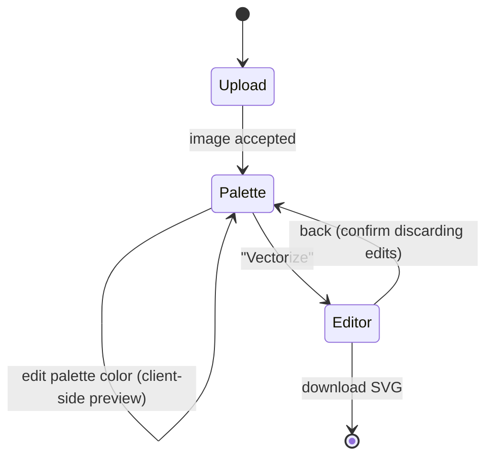

# 07. Frontend Application

## Technology stack

| Purpose | Library |
|---------|---------|
| UI framework | React 18 + TypeScript |
| Build tool / dev server | Vite |
| State management | Zustand (with a command-based undo/redo history) |
| Vector editing | Paper.js (hit-testing, boolean path operations, SVG import/export) |
| Color picker | Native `<input type="color">` (richer picker planned) |
| Linting / formatting | ESLint, Prettier |
| Tests | Vitest + React Testing Library, Playwright (E2E, later) |

## Screen flow

The application is a single page with a three-step wizard. Steps stay accessible after
completion so the user can go back (e.g. change the color count) without losing edits
made in later steps — going back invalidates later steps only after confirmation.



### Step 1 — Upload

- Drop zone + "Choose file" button + paste from clipboard.
- Client-side checks against `GET /api/v1/limits` (type, size); the backend remains
  authoritative.
- Shows original image thumbnail, dimensions and file size.

### Step 2 — Colors & palette

Layout: left = preview, right = controls.

- **Color count**: slider + numeric input (`min_colors`…`max_colors`, default 8).
  Changing it triggers `POST /quantize` (debounced 400 ms, previous request aborted via
  `AbortController`).
- **Algorithm**: k-means / median cut toggle.
- **Preview**: side-by-side or swipe comparison original vs. quantized.
- **Palette list**: one row per color — swatch, hex, coverage bar.
  - Click swatch → color picker; edits are previewed **instantly client-side** by
    re-rendering the indexed PNG on a `<canvas>` with the new palette (no server call).
  - Hover a row → highlight pixels of that color in the preview.
  - Merge: drag one swatch onto another (sets both indices to the same color).
  - Reset single color / reset all.
- **Tracing options** (collapsible "Advanced"): mode, speckle filter, corner threshold,
  path precision, stacking.
- **Vectorize** button → `POST /vectorize` with the indexed PNG and edited palette.

### Step 3 — SVG editor

Described in detail in [08-svg-editor.md](08-svg-editor.md). Includes the **Download SVG**
action and a file-size / path-count indicator.

## Component tree

```
App
├── StepNav
├── UploadStep
│   └── ImageUpload
├── PaletteStep
│   ├── ColorCountSelector
│   ├── QuantizedPreview
│   ├── PaletteEditor
│   │   └── PaletteSwatch (× N) → ColorPicker
│   └── TracingOptions
└── EditorStep
    ├── EditorToolbar        (select, knife, lasso, recolor, merge, delete, undo/redo, zoom)
    ├── SvgCanvas            (Paper.js canvas)
    ├── EditorPalettePanel   (palette groups, recolor whole group)
    └── ShapeInspector       (selected shape: color, area, id)
```

## State

```ts
interface AppState {
  step: 'upload' | 'palette' | 'editor';
  source: { file: File; width: number; height: number } | null;
  quantize: {
    params: { colors: number; algorithm: 'kmeans' | 'median_cut' };
    result: QuantizeResponse | null;   // indexed PNG + original palette
    paletteOverrides: Record<number, string>; // index → hex
    status: 'idle' | 'loading' | 'error';
  };
  vectorize: {
    options: TracingOptions;
    result: VectorizeResponse | null;
    status: 'idle' | 'loading' | 'error';
  };
  editor: EditorState; // see 08-svg-editor.md
}
```

- Server data and UI state live in a single Zustand store split into slices.
- The editor document itself lives in Paper.js; the store holds the undo history and
  selection, not a duplicated copy of the geometry.

## API client (`src/api/client.ts`)

- Thin typed wrapper over `fetch`; base URL from `VITE_API_BASE_URL` (default `/api`).
- Converts the error envelope into a typed `ApiError` (`code`, `message`, `requestId`).
- All calls accept an `AbortSignal`.
- TypeScript types in `src/types/api.ts` mirror the OpenAPI schema; generating them with
  `openapi-typescript` is planned once the API stabilizes.

## UX requirements

- Every server call shows a progress indicator; errors are shown inline with the
  backend message and a retry action.
- Keyboard shortcuts in the editor (see [08](08-svg-editor.md#keyboard-shortcuts)).
- Responsive down to 1024 px width (editor); upload/palette steps usable on tablets.
- Accessible: all controls keyboard reachable, color swatches labelled with hex values,
  contrast AA.

## Dev server

`vite.config.ts` proxies `/api` → `http://localhost:8000`, so the same relative base URL
works in development and in the nginx container.
