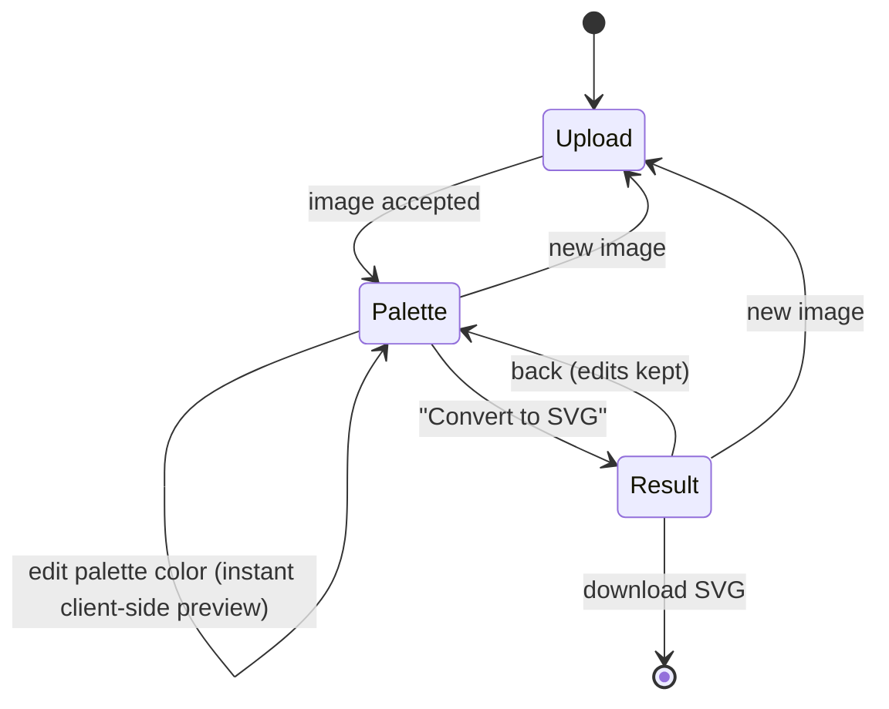

# 07. Frontend Application

## Technology stack

| Purpose | Library |
|---------|---------|
| UI framework | React 18 + TypeScript |
| Build tool / dev server | Vite |
| State management | Zustand (with a command-based undo/redo history) |
| Vector editing | Paper.js (hit-testing, boolean path operations, SVG import/export) |
| 3D preview | three.js (3MFLoader, OrbitControls), lazy-loaded |
| Color picker | Native `<input type="color">` (richer picker planned) |
| Linting / formatting | ESLint, Prettier |
| Tests | Vitest + React Testing Library, Playwright (E2E, later) |

## Screen flow

The application is a single page with a three-step wizard. Going back to the colors step
keeps the palette edits; changing the color count or method re-quantizes and resets them
(palette indices change).

The step indicator in the header is the navigation: completed steps show a check mark,
and every step that is reachable (`reachableSteps` in the store — colors once an image is
chosen, SVG once it has been converted) is a button, so the user can jump between the
colors and the editor without losing edits. `goTo` ignores unreachable steps.



Status legend: ✅ implemented · 🔜 planned (see [Roadmap](11-roadmap.md)).

### Step 1 — Upload ✅

- Drop zone, file picker and paste from clipboard; only JPEG/PNG are accepted. The zone
  highlights while a file is dragged over it ("Release to upload"); the file input is
  visually hidden inside a styled "Choose image" button and stays keyboard reachable.
- Accepted formats and the upload limit (`max_upload_mb`) are shown under the button.
- **Try a sample**: loads the bundled `public/sample.png` (a flat-color logo with
  anti-aliased edges, `src/lib/sample.ts`) as if it had been chosen, so the whole
  workflow can be tried without a file.
- File size is checked against `GET /api/v1/limits` (loaded on startup, defaults used if
  unavailable); the backend remains authoritative — its error message is shown inline.

### Step 2 — Colors & palette ✅

Layout: left = original and quantized previews side by side, right = controls.

- **Color count**: slider + numeric input (`min_colors`…`max_colors`, default 8).
  Changing it triggers `POST /quantize`, debounced 400 ms; a newer request aborts the
  previous one (`AbortController`). Unchanged parameters never re-quantize, so returning
  from the result step keeps edits.
- **Suggest**: asks `POST /suggest-colors` for a color count and applies it (clamped to
  the limits and the number of locked colors); a hint shows the suggestion with a "use
  it" link once the count is changed. Runs with its own `AbortController`, so it never
  cancels a quantization in flight.
- **Method**: perceptual (k-means) / fast (median cut).
- **Remove colors / background**: the eye toggle on a palette row leaves that color out
  of the SVG (sent as `transparent`); the preview shows it as transparent over a
  checkerboard. "Remove background" appears when `/quantize` reports a
  `background_index`. At least one color always stays, and removed colors are reset
  whenever the image is quantized again (indices change).
- **Locked colors** (FR-16): the lock toggle on a palette row, or "Lock color" with a
  color picker for brand colors, adds a color to `locked`. Locked colors are sent as
  `locked_colors` and re-quantize (debounced like the color count); the backend keeps
  them exactly in the palette. At most `colors` colors can be locked, and the color count
  cannot go below the number of locked colors. Locked colors persist across images until
  "New image".
- **Palette list**: one row per color — color picker, hex value, coverage bar, per-color
  reset and "Reset all".
  - Edits are previewed **instantly client-side**: the indexed PNG is decoded onto a
    `<canvas>` and every pixel is mapped from its original palette color to the edited
    color (`src/lib/recolor.ts`) — no server call.
  - Merge: give two colors the same value; they become one region in the SVG.
  - 🔜 Hover highlighting, drag-to-merge.
- **Tracing options** (collapsible): curves (spline/polygon), shapes (cutout/stacked),
  speck filter, corner threshold and an **Advanced** subsection with minimum segment
  length, splice threshold (both spline only, disabled in polygon mode) and coordinate
  precision (FR-24). Values are clamped to the ranges accepted by `POST /vectorize`
  (`src/lib/tracing.ts`); "Restore defaults" resets all tracing options.
- **Convert to SVG** → `POST /vectorize` with the indexed PNG and the final palette.

### Step 3 — SVG editor

- ✅ Interactive canvas ([08-svg-editor.md](08-svg-editor.md)): select shapes by click
  (with hover preview), box selection, `Ctrl/Cmd+A`; pan (Hand tool, `Space`+drag, middle
  button), zoom (wheel, toolbar, `+`/`-`/`0`); inspector with the selected shapes.
- ✅ Recolor the selection (own color / back to group color) and whole color groups.
- ✅ Knife tool: split shapes along a freehand or straight line.
- ✅ Lasso tool: cut a freehand region out of a shape.
- ✅ Select shapes smaller than an area (specks) to delete, recolor or move them at once.
- ✅ Merge shapes and move them between color groups.
- ✅ Export panel (STL, 3MF, DXF, PDF) with per-color heights and a 3D preview with print
  statistics ([13-export-formats.md](13-export-formats.md)).
- ✅ Delete shapes, undo/redo every edit (toolbar and keyboard).
- ✅ **Compare with original**: a view switch above the editor shows the original upload
  and the current (edited) SVG on top of each other, split by a divider that follows the
  pointer (drag) or a range slider (keyboard). The stage keeps the image's aspect ratio,
  so the divider position is relative to the image; switching back remounts the editor.
- ✅ Shape count, file size, tracing time, back to colors, new image.
- ✅ Download exports the **edited** document in the SVG contract; shape count and file
  size reflect the edits.

## Component tree

```
App                         header with step indicator, error banner
├── ImageUpload             (step: upload)
├── PaletteStep             (step: palette)
│   ├── ColorCountSelector
│   ├── QuantizedPreview    canvas, client-side recoloring
│   ├── PaletteEditor
│   └── TracingOptionsPanel
└── ResultStep              (step: result) — stats, download
    ├── SvgEditor           Paper.js canvas + view toolbar (docs/08)
    ├── ShapeInspector      selected shapes, selection color
    └── EditorPalettePanel  color groups: recolor, select group
```

## State

A single Zustand store (`useAppStore`) holds UI state, server results and the async
actions. It is composed of two slices: the conversion workflow (`src/state/store.ts`) and
the SVG editor (`src/state/editorSlice.ts` — document, selection, undo/redo history and
the editing actions, see [08-svg-editor.md](08-svg-editor.md)):

```ts
type AppState = WorkflowSlice & EditorSlice;

interface WorkflowSlice {
  step: 'upload' | 'palette' | 'result';
  limits: { min_colors: number; max_colors: number; max_upload_mb: number };
  file: File | null;
  colors: number;
  algorithm: 'kmeans' | 'median_cut';
  quantized: QuantizeResponse | null;        // indexed PNG + original palette
  quantizedFor: { file; colors; algorithm; locked } | null; // params that produced `quantized`
  suggestedColors: number | null;            // from POST /suggest-colors, per file
  suggesting: boolean;
  locked: string[];                          // colors kept exactly in the palette (FR-16)
  overrides: Record<number, string>;         // palette index → edited hex
  tracing: TracingOptions;                   // defaults: DEFAULT_TRACING (lib/tracing.ts)
  vectorized: VectorizeResponse | null;
  status: 'idle' | 'quantizing' | 'vectorizing';
  error: string | null;
  // actions: loadLimits, selectFile, setColors, setAlgorithm, suggestColors, lockColor,
  // unlockColor, setOverride, resetOverride, resetOverrides, setTracing, resetTracing,
  // runQuantize, runVectorize, goTo, reset
}

interface EditorSlice {
  editor: EditorDoc | null;                  // editable document built from vectorized.svg
  selection: string[];                       // selected shape ids
  history: History;                          // undo/redo snapshots of `editor`
  notice: string | null;                     // why an edit did nothing
  // actions: select, selectMany, selectAll, recolorSelection, resetSelectionColor,
  // recolorGroup, splitWithLine, cutWithLasso, deleteSelection, mergeSelection,
  // moveSelectionToGroup, undo, redo
}
```

- Only one request is in flight at a time; starting a new one aborts the previous one,
  and aborted requests never surface as errors.
- Pure logic lives in `src/lib/` (color conversion, recoloring, base64) and `src/state/`,
  and is unit-tested with Vitest; components are covered by E2E tests (planned).
- The editor document is an immutable `EditorDoc` in the store; Paper.js only renders it.

## API client (`src/api/client.ts`)

- Thin typed wrapper over `fetch`; base URL from `VITE_API_BASE_URL` (default `/api`).
- Converts the error envelope into a typed `ApiError` (`code`, `message`, `requestId`).
- All calls accept an `AbortSignal`.
- TypeScript types in `src/types/api.ts` mirror the OpenAPI schema; generating them with
  `openapi-typescript` is planned once the API stabilizes.

## UX requirements

- Every server call shows a progress indicator; errors are shown inline with the
  backend message and a retry action.
- Keyboard shortcuts in the editor (see [08](08-svg-editor.md#keyboard-shortcuts)).
- Responsive down to 1024 px width (editor); upload/palette steps usable on tablets.
- Accessible: all controls keyboard reachable, color swatches labelled with hex values,
  contrast AA.

## Dev server

`vite.config.ts` proxies `/api` → `http://localhost:8000`, so the same relative base URL
works in development and in the nginx container.
