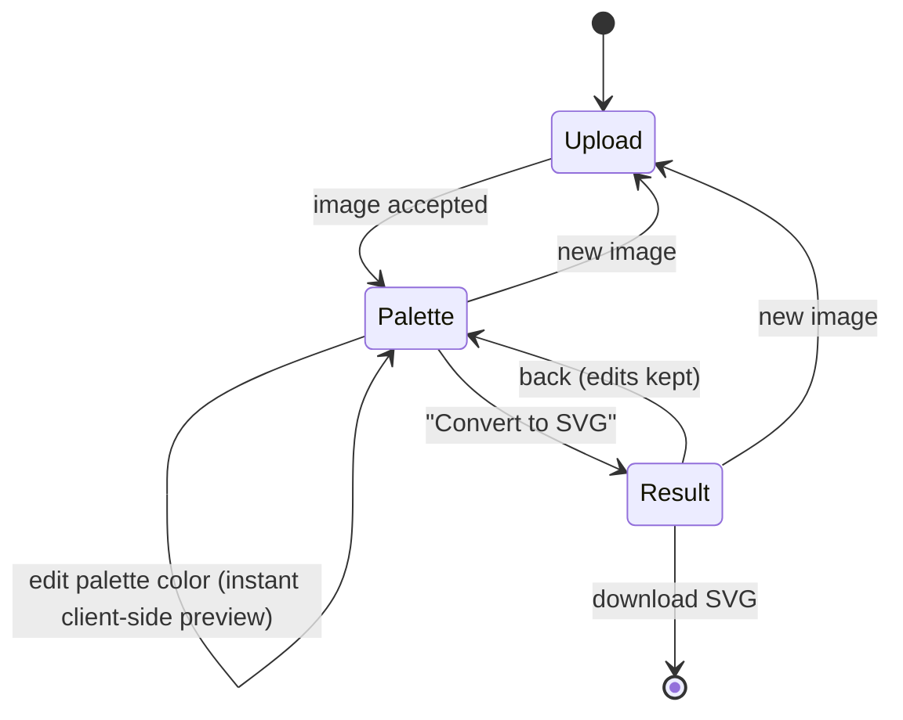

# 07. Frontend Application

## Technology stack

| Purpose | Library |
|---------|---------|
| UI framework | React 18 + TypeScript |
| Build tool / dev server | Vite |
| State management | Zustand (with a command-based undo/redo history) |
| Vector editing | Paper.js (hit-testing, boolean path operations, SVG import/export) |
| Color picker | Native `<input type="color">` (richer picker planned) |
| Linting / formatting | ESLint, Prettier |
| Tests | Vitest + React Testing Library, Playwright (E2E, later) |

## Screen flow

The application is a single page with a three-step wizard. Going back to the colors step
keeps the palette edits; changing the color count or method re-quantizes and resets them
(palette indices change).



Status legend: ✅ implemented · 🔜 planned (see [Roadmap](11-roadmap.md)).

### Step 1 — Upload ✅

- Drop zone, file picker and paste from clipboard; only JPEG/PNG are accepted.
- File size is checked against `GET /api/v1/limits` (loaded on startup, defaults used if
  unavailable); the backend remains authoritative — its error message is shown inline.

### Step 2 — Colors & palette ✅

Layout: left = original and quantized previews side by side, right = controls.

- **Color count**: slider + numeric input (`min_colors`…`max_colors`, default 8).
  Changing it triggers `POST /quantize`, debounced 400 ms; a newer request aborts the
  previous one (`AbortController`). Unchanged parameters never re-quantize, so returning
  from the result step keeps edits.
- **Method**: perceptual (k-means) / fast (median cut).
- **Palette list**: one row per color — color picker, hex value, coverage bar, per-color
  reset and "Reset all".
  - Edits are previewed **instantly client-side**: the indexed PNG is decoded onto a
    `<canvas>` and every pixel is mapped from its original palette color to the edited
    color (`src/lib/recolor.ts`) — no server call.
  - Merge: give two colors the same value; they become one region in the SVG.
  - 🔜 Hover highlighting, drag-to-merge.
- **Tracing options** (collapsible): curves (spline/polygon), shapes (cutout/stacked),
  speck filter, corner threshold.
- **Convert to SVG** → `POST /vectorize` with the indexed PNG and the final palette.

### Step 3 — SVG editor

- ✅ Interactive canvas ([08-svg-editor.md](08-svg-editor.md)): select shapes
  (click, `Shift`+click), pan (drag), zoom (wheel, toolbar, `+`/`-`/`0`), inspector with
  the selected shapes' ids and colors.
- ✅ Shape count, file size, processing time, colors used, **Download SVG**
  (`<original-name>.svg`), back to colors, new image.
- 🔜 Recoloring, splitting, deleting, undo/redo and export of the edited document.

## Component tree

```
App                         header with step indicator, error banner
├── ImageUpload             (step: upload)
├── PaletteStep             (step: palette)
│   ├── ColorCountSelector
│   ├── QuantizedPreview    canvas, client-side recoloring
│   ├── PaletteEditor
│   └── TracingOptionsPanel
└── ResultStep              (step: result) — stats, download
    ├── SvgEditor           Paper.js canvas + view toolbar (docs/08)
    └── ShapeInspector      selected shapes
```

## State

A single Zustand store (`src/state/store.ts`) holds UI state, server results and the
async actions:

```ts
interface AppState {
  step: 'upload' | 'palette' | 'result';
  limits: { min_colors: number; max_colors: number; max_upload_mb: number };
  file: File | null;
  colors: number;
  algorithm: 'kmeans' | 'median_cut';
  quantized: QuantizeResponse | null;        // indexed PNG + original palette
  quantizedFor: { file; colors; algorithm } | null; // params that produced `quantized`
  overrides: Record<number, string>;         // palette index → edited hex
  tracing: TracingOptions;                   // defaults: spline, cutout, speckle 4
  vectorized: VectorizeResponse | null;
  editor: EditorDoc | null;                  // editable document (docs/08)
  selection: string[];                       // selected shape ids
  status: 'idle' | 'quantizing' | 'vectorizing';
  error: string | null;
  // actions: loadLimits, selectFile, setColors, setAlgorithm, setOverride, resetOverride,
  // resetOverrides, setTracing, runQuantize, runVectorize, goTo, reset
}
```

- Only one request is in flight at a time; starting a new one aborts the previous one,
  and aborted requests never surface as errors.
- Pure logic lives in `src/lib/` (color conversion, recoloring, base64) and `src/state/`,
  and is unit-tested with Vitest; components are covered by E2E tests (planned).
- The editor document is an immutable `EditorDoc` in the store; Paper.js only renders it.

## API client (`src/api/client.ts`)

- Thin typed wrapper over `fetch`; base URL from `VITE_API_BASE_URL` (default `/api`).
- Converts the error envelope into a typed `ApiError` (`code`, `message`, `requestId`).
- All calls accept an `AbortSignal`.
- TypeScript types in `src/types/api.ts` mirror the OpenAPI schema; generating them with
  `openapi-typescript` is planned once the API stabilizes.

## UX requirements

- Every server call shows a progress indicator; errors are shown inline with the
  backend message and a retry action.
- Keyboard shortcuts in the editor (see [08](08-svg-editor.md#keyboard-shortcuts)).
- Responsive down to 1024 px width (editor); upload/palette steps usable on tablets.
- Accessible: all controls keyboard reachable, color swatches labelled with hex values,
  contrast AA.

## Dev server

`vite.config.ts` proxies `/api` → `http://localhost:8000`, so the same relative base URL
works in development and in the nginx container.
