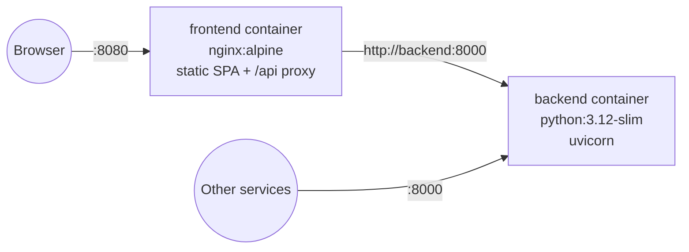

# 09. Containerization

## Overview



| Service | Image base | Port (container → host) | Healthcheck |
|---------|------------|-------------------------|-------------|
| `backend` | `python:3.12-slim` | `8000 → 8000` | `GET /api/v1/health` |
| `frontend` | `node:24-alpine` (build) → `nginx:1.27-alpine` (runtime) | `80 → 8080` | `GET /` |

## Backend image (`backend/Dockerfile`)

Multi-stage build:

1. **builder** — installs dependencies into a virtualenv (`/opt/venv`) using
   `pyproject.toml`. Build tools are only present in this stage.
2. **runtime** — copies the virtualenv and the `app/` package, creates an unprivileged
   `app` user, sets `PYTHONDONTWRITEBYTECODE=1`, `PYTHONUNBUFFERED=1`, and starts
   `uvicorn app.main:app --host 0.0.0.0 --port 8000 --workers ${UVICORN_WORKERS}`.

The backend image is self-contained and can be deployed without the frontend — this is
the "microservice" deployment mode.

## Frontend image (`frontend/Dockerfile`)

1. **build** — `npm ci && npm run build` producing `dist/`.
2. **runtime** — `nginx:alpine` serving `dist/` with `frontend/nginx.conf`:
   - SPA fallback (`try_files $uri /index.html`).
   - `location /api/` → `proxy_pass http://backend:8000` with
     `client_max_body_size` matching the backend upload limit.
   - Long-term caching for hashed assets, `no-cache` for `index.html`.
   - Security headers (`X-Content-Type-Options`, `Referrer-Policy`, CSP).

`VITE_API_BASE_URL` is a build-time variable (default `/api`). When the frontend is
deployed against a remote backend, pass it as a build arg.

## Docker Compose

`docker-compose.yml` at the repository root:

- `backend` — built from `./backend`, reads `.env`, healthcheck on `/api/v1/health`.
- `frontend` — built from `./frontend`, `depends_on: backend (service_healthy)`.
- Both on a private bridge network `vectorsnap`.

Common commands:

```bash
docker compose up --build          # build & start everything
docker compose up backend          # backend only (microservice mode)
docker compose logs -f backend
docker compose down
```

### Development override

`docker-compose.dev.yml` (planned) mounts source directories and runs
`uvicorn --reload` and `vite dev` for hot reload inside containers:

```bash
docker compose -f docker-compose.yml -f docker-compose.dev.yml up
```

## Resource guidelines

| Service | CPU | Memory | Notes |
|---------|-----|--------|-------|
| backend | 1–2 vCPU per worker | 512 MB–1 GB per worker | Memory scales with image size (4096² RGBA ≈ 64 MB + intermediate arrays) |
| frontend | 0.1 vCPU | 32 MB | Static files only |

## Production notes

- Put a TLS-terminating reverse proxy / ingress in front of the frontend.
- Run multiple backend replicas behind a load balancer; no sticky sessions needed.
- Images are tagged `vectorsnap-backend:<version>` / `vectorsnap-frontend:<version>`
  with `<version>` from the git tag; CI publishing to a registry is on the roadmap.
