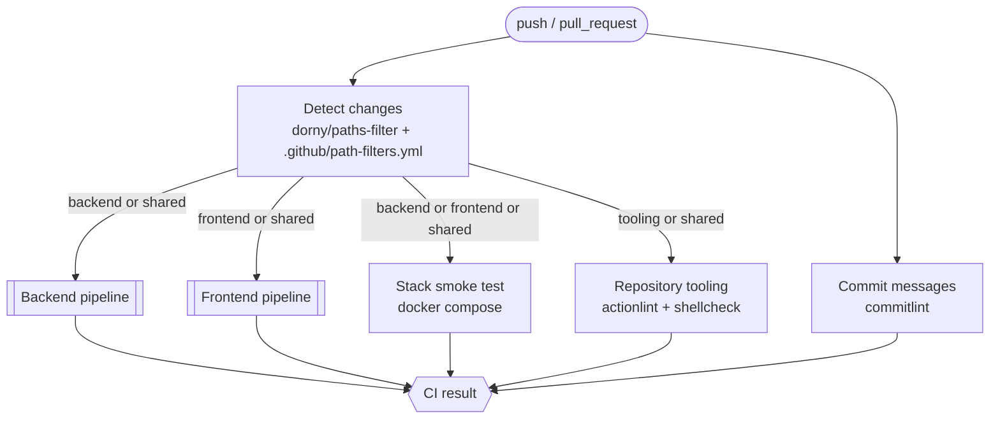

# 12. Continuous Integration

CI runs on **GitHub Actions**. The repository is a monorepo, so the pipeline is
**path-aware**: a change to the backend runs only the backend pipeline, a change to the
frontend runs only the frontend pipeline, and a change to a shared file (e.g.
`.gitignore`) runs everything. Commit messages are validated on every run.

## Files

| File | Purpose |
|------|---------|
| [`.github/workflows/ci.yml`](../.github/workflows/ci.yml) | Orchestrator: change detection, commit lint, tooling lint, calls the pipelines, final gate |
| [`.github/workflows/backend.yml`](../.github/workflows/backend.yml) | Reusable backend pipeline (`workflow_call`) |
| [`.github/workflows/frontend.yml`](../.github/workflows/frontend.yml) | Reusable frontend pipeline (`workflow_call`) |
| [`.github/workflows/pr-title.yml`](../.github/workflows/pr-title.yml) | Validates the PR title (becomes the squash commit) |
| [`.github/path-filters.yml`](../.github/path-filters.yml) | **Single source of truth** for path → pipeline mapping |
| [`.github/actions/setup-backend`](../.github/actions/setup-backend/action.yml) | Composite action: Python + pip cache + `pip install -e .[dev]` |
| [`.github/actions/setup-frontend`](../.github/actions/setup-frontend/action.yml) | Composite action: Node (from `.nvmrc`) + npm cache + `npm ci` |
| [`.github/dependabot.yml`](../.github/dependabot.yml) | Weekly dependency updates with Conventional Commit messages |
| [`commitlint.config.mjs`](../commitlint.config.mjs) | Commit message rules |
| [`scripts/lint-commits.sh`](../scripts/lint-commits.sh) | Commitlint wrapper used by CI, the git hook and `make` |
| [`scripts/ci/smoke-test.sh`](../scripts/ci/smoke-test.sh) | Starts a container and waits for an HTTP endpoint |
| [`scripts/ci/coverage-summary.mjs`](../scripts/ci/coverage-summary.mjs) | Renders frontend coverage into the job summary |
| [`.hadolint.yaml`](../.hadolint.yaml) | Dockerfile lint rules |

## Triggers

| Event | Behavior |
|-------|----------|
| `pull_request` (any branch) | Path-filtered pipelines against the PR base |
| `push` to `main` | Path-filtered pipelines against the previous `main` commit |
| `workflow_dispatch` (manual) | **All** pipelines, regardless of changes |

Runs on the same PR are de-duplicated (`concurrency`): a new push cancels the running
pipeline for that PR. Runs on `main` are never cancelled.

## Path-based triggering



Rules from [`.github/path-filters.yml`](../.github/path-filters.yml):

| Group | Paths | Runs |
|-------|-------|------|
| `backend` | `backend/**`, `.github/workflows/backend.yml`, `.github/actions/setup-backend/**` | Backend pipeline, stack smoke test |
| `frontend` | `frontend/**`, `.github/workflows/frontend.yml`, `.github/actions/setup-frontend/**` | Frontend pipeline, stack smoke test |
| `shared` | `.gitignore`, `.editorconfig`, `.env.example`, `.hadolint.yaml`, `docker-compose*.yml`, `Makefile`, `scripts/ci/**`, `.github/path-filters.yml`, `.github/workflows/ci.yml` | **Everything** |
| `tooling` | `.github/**`, `scripts/**`, `.githooks/**` | Repository tooling lint |
| *(always)* | — | Commit messages, CI result |

Examples:

| Changed files | Backend | Frontend | Stack | Tooling |
|---------------|:-:|:-:|:-:|:-:|
| `backend/app/main.py` | ✅ | — | ✅ | — |
| `frontend/src/App.tsx` | — | ✅ | ✅ | — |
| `backend/…` + `frontend/…` | ✅ | ✅ | ✅ | — |
| `.gitignore` | ✅ | ✅ | ✅ | ✅ |
| `docs/03-architecture.md`, `README.md` | — | — | — | — |
| `.github/workflows/backend.yml` | ✅ | — | ✅ | ✅ |

Documentation-only changes run only the commit message check and the gate.

### Adding a new path rule

1. Edit `.github/path-filters.yml` (add the path to an existing group, or add a new group).
2. For a new group, expose it in the `changes` job outputs in `ci.yml` and use it in the
   relevant job's `if:`.
3. Update the tables above.

## Backend pipeline

Defined in `backend.yml`; all jobs run in parallel on `ubuntu-24.04`.

| Job | What it checks | Fails when |
|-----|----------------|------------|
| **Lint & format** | `ruff check` (rules: pycodestyle, pyflakes, isort, bugbear, pyupgrade, simplify, ruff) with inline PR annotations; `ruff format --check --diff` | Any lint error or unformatted file |
| **Type check** | `mypy app tests` (strict mode for `app/services`) | Any type error |
| **Test (Python 3.12, 3.13)** | `pytest` with branch coverage, matrix over supported Python versions; JUnit + Cobertura reports uploaded as artifacts; coverage table in the job summary | Test failure or coverage < **80%** (`[tool.coverage.report] fail_under`) |
| **Dependency audit** | `pip-audit` against the PyPI advisory DB / OSV | A dependency has a known vulnerability |
| **Docker image** | `hadolint` on the Dockerfile → BuildKit build with GitHub Actions layer cache → container smoke test on `/api/v1/health` | Dockerfile lint warning, build failure, or the container doesn't become healthy in 60 s |

## Frontend pipeline

Defined in `frontend.yml`; all jobs run in parallel on `ubuntu-24.04`.

| Job | What it checks | Fails when |
|-----|----------------|------------|
| **Lint & format** | ESLint (`--max-warnings 0`), Prettier `--check` | Any lint warning/error or unformatted file |
| **Type check** | `tsc -b --noEmit` (strict) | Any type error |
| **Test** | Vitest with V8 coverage; JUnit + Cobertura uploaded; coverage table in job summary | Test failure or coverage below thresholds (lines/functions/statements 80%, branches 70%) |
| **Build** | Production `vite build`; `dist/` uploaded as artifact (7 days) | Build error |
| **Dependency audit** | `npm audit --omit=dev --audit-level=high` | High/critical vulnerability in production dependencies |
| **Docker image** | `hadolint` → BuildKit build with cache → nginx smoke test on `/` | Same as backend |

> Coverage scope: UI components (`src/components/**`, `App.tsx`) are excluded from unit
> coverage; they will be covered by Playwright E2E tests (see [Roadmap](11-roadmap.md)).

## Stack smoke test

Runs when the backend, the frontend or shared files changed. It executes
`docker compose up --build --wait` using `.env.example`, then verifies through nginx that
the SPA is served (`GET /`) and that the API proxy works (`GET /api/v1/health`). On
failure, all service logs are printed.

## Commit message checks

Every commit must follow [Conventional Commits](https://www.conventionalcommits.org/)
(see [Development workflow](10-development-workflow.md#commit-messages--conventional-commits)).

| Where | What is checked |
|-------|-----------------|
| `CI / Commit messages` on PRs | Every commit between the PR base and head |
| `CI / Commit messages` on `main` | Every commit in the push (`before..after`); latest commit for new branches |
| `PR title / Conventional PR title` | The PR title — re-checked when the title is edited |
| Local `commit-msg` hook (optional) | The message being committed (`make hooks` to enable) |

Rules (`commitlint.config.mjs`) extend `@commitlint/config-conventional`:

- `type` ∈ `build, chore, ci, docs, feat, fix, perf, refactor, revert, style, test`
- `scope` (optional) ∈ `backend, frontend, api, editor, docker, docs, adr, ci, deps, deps-dev, release`
- header ≤ 100 characters (aim for ≤ 72), subject not in sentence/start/pascal/upper case,
  no trailing period
- body and footer line length are not limited (URLs, generated text)
- merge commits generated by Git are ignored

Check locally:

```bash
make hooks                                    # validate every commit automatically
make lint-commits                             # validate all commits on your branch vs origin/main
echo "feat(api): add limits endpoint" | scripts/lint-commits.sh
```

## Repository tooling

Runs when anything under `.github/`, `scripts/` or `.githooks/` changes:

- **actionlint** — validates workflow syntax, expressions, action inputs, and runs
  shellcheck on every `run:` block.
- **shellcheck** — lints shell scripts and git hooks.

## Required status checks (branch protection)

Because pipelines are skipped when their paths don't change, individual jobs cannot be
marked as required (a skipped required check blocks the merge). Instead, the single
`CI result` job aggregates everything: it **passes only if every job either succeeded or
was skipped** and fails otherwise (including cancelled runs).

Configure branch protection / a ruleset for `main`:

1. *Settings → Rules → Rulesets → New branch ruleset*, target `main`.
2. Enable **Require a pull request before merging** and **Require status checks to pass**.
3. Add the required checks:
   - `CI result`
   - `Conventional PR title`
4. Enable **Require branches to be up to date before merging**.
5. *Settings → General → Pull Requests*: allow **squash merging** only, with
   "Default commit message: Pull request title" — so the validated PR title becomes the
   commit on `main`.
6. Block force pushes and deletions.

## Security & reliability practices

- **Least privilege:** workflows default to `permissions: contents: read`; only the
  change-detection job gets `pull-requests: read`. No secrets are used.
- **Pinned actions:** third-party actions are pinned to a full commit SHA (with the
  version in a comment) to prevent tag hijacking; Dependabot keeps the SHAs up to date.
- **No credential persistence:** `actions/checkout` runs with `persist-credentials: false`.
- **Script-injection safe:** untrusted context values (PR title, SHAs) are passed through
  `env:` and never interpolated directly into `run:` scripts.
- **Timeouts** on every job; **`fail-fast: false`** in matrices so all Python versions
  report results.
- **Caching:** pip and npm caches keyed on `pyproject.toml` / `package-lock.json`;
  Docker layers cached in the GitHub Actions cache per service (`scope=backend|frontend`).

## Dependency updates

Dependabot opens weekly grouped PRs for GitHub Actions, pip (`backend/`), npm
(`frontend/`) and Docker base images, using Conventional Commit messages
(`ci(deps): …`, `build(deps): …`, `build(deps-dev): …`) so they pass commitlint.
Their CI runs through the same path filters, so a backend dependency bump runs only the
backend pipeline.

## Updating tool versions

| Tool | Where the version lives |
|------|-------------------------|
| Python | `backend/.python-version` (default) and the test matrix in `backend.yml` |
| Node.js | `frontend/.nvmrc` (CI, local) and `frontend/Dockerfile` |
| commitlint | `COMMITLINT_VERSION` in `scripts/lint-commits.sh` |
| actionlint | Docker image tag in `ci.yml` (`tooling` job) |
| GitHub Actions | SHA pins — updated by Dependabot |
| ruff, mypy, pytest, pip-audit | `backend/pyproject.toml` (`[project.optional-dependencies].dev`) |
| ESLint, Prettier, Vitest | `frontend/package.json` |

## Reproducing CI locally

```bash
make ci                 # backend + frontend: lint, typecheck, tests with coverage
make lint-commits       # commit messages
docker compose up --build --wait && curl -f localhost:8080/api/v1/health   # stack smoke test
docker run --rm -v "$PWD:/repo" -w /repo rhysd/actionlint:1.7.12           # workflows
```

## Troubleshooting

| Symptom | Cause / fix |
|---------|-------------|
| `CI result` fails but all visible jobs are green | A job was **cancelled** (e.g. superseded push) — re-run, or check the list printed by the `CI result` step |
| Commit messages job fails on an old commit | Reword it with `git rebase -i` (or squash) and force-push the PR branch |
| PR title check fails | Edit the title, e.g. `feat(editor): add lasso split` — the check re-runs automatically |
| Coverage threshold failure | Add tests; thresholds are intentional (NFR-10) and should not be lowered without discussion |
| `pip-audit` / `npm audit` failure without code changes | A new advisory was published — upgrade the dependency (or wait for the Dependabot PR) |
| Frontend container fails smoke test with `host not found in upstream "backend"` | nginx needs the `backend` host to resolve; the standalone test passes `--add-host backend:127.0.0.1` |
